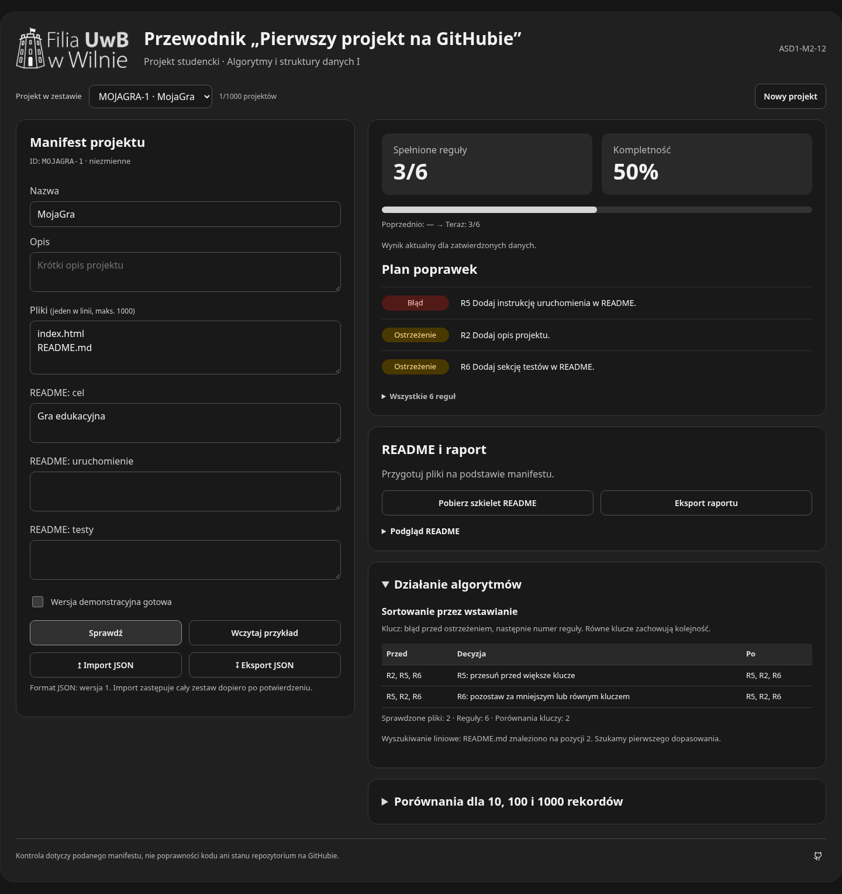

# Przewodnik
# „Pierwszy projekt na GitHubie”

**Deividas Dirma** · ASD1-M2-12
Algorytmy i struktury danych I · M2 · 2026/2027

Cel: sprawdzić manifest projektu i utworzyć plan poprawek.
Lokalnie, bez logowania i połączenia z GitHub API.

<!-- Temat oficjalny. Wyjaśnij różnicę: aplikacja nie łączy się z GitHubem, ale kod trzeba oddać w repozytorium. -->

---

## Użytkownik i problem

Początkujący autor repozytorium nie wie, czego brakuje.

1. Wczytuje **MojaGra**: opis i część README są puste.
2. Otrzymuje **3/6 = 50%** i uporządkowany plan.
3. Dodaje uruchomienie: **4/6 = 66,7%**.
4. Pobiera szkielet README i raport kontroli.

Nie sprawdzamy jakości kodu ani prawdziwości deklaracji.

---

## Zakres i reguły

| Błędy | Ostrzeżenia |
|---|---|
| R1: niepusta nazwa | R2: niepusty opis |
| R3: dokładnie README.md | R4: niepusty cel |
| R5: niepuste uruchomienie | R6: niepuste testy |

R4–R6 działają niezależnie od R3.
Kolejność: **błędy → ostrzeżenia → numer reguły**.
Import/eksport JSON, README, raport, ponowna kontrola i porównanie.

---

## Model danych

- Zestaw: `formatVersion: 1`, tablica `projects`.
- Projekt: ID, nazwa, opis, ścieżki, sekcje README, demoReady.
- Reguła: ID, numer, ważność, etykieta, instrukcja naprawy.
- Wynik: spełnione warunki, problemy, ślad, liczniki.

Do **1000 projektów**, do **1000 plików** na projekt.
ID unikalne, niepuste i nieedytowalne w formularzu.
Flaga demonstracji **nie jest siódmą regułą**.

---

## Własne algorytmy

```text
Wyszukiwanie: odwiedzaj pliki do pierwszego README.md.
Sortowanie: weź kolejny problem; przesuwaj większe klucze;
            wstaw problem w zwolnione miejsce.
```

| Przed | Decyzja | Po |
|---|---|---|
| R2, R5, R6 | R5 jest błędem: przed R2 | R5, R2, R6 |
| R5, R2, R6 | R6 zostaje za R2 | R5, R2, R6 |

2 sprawdzone pliki, 2 porównania kluczy.
Wyszukiwanie O(f); sortowanie O(k)–O(k²), stabilne.

---

## Technologia i architektura

**HTML + CSS + JavaScript**, bez frameworków i zależności aplikacji.

- `core.js`: walidacja, reguły, algorytmy, generowanie plików.
- `app.js`: szkic i stan, zdarzenia, bezpieczny widok.
- `index.html`: formularz i natywne `details/summary`.
- Import: pełna walidacja → potwierdzenie → zastąpienie stanu.
- Eksport: JSON w wersji 1; brak trwałego zapisu po odświeżeniu.

Uruchomienie: **index.html** lub `npm start`.
Testy: **npm test** — bez `npm install`.

---

## Interfejs i droga użytkownika



Formularz → Sprawdź → plan poprawek → edycja → nowy wynik.

Stary wynik po edycji jest oznaczony.
Rozwijane sekcje pokazują szczegóły.

Obok: rzeczywisty zrzut działającej aplikacji, nie makieta AI.

---

## Testy i rzeczywiste porównania

**22/22 testy logiki**, dodatkowo **19 scenariuszy UI**.

| Rekordy | Uporządkowane | Odwrócone |
|---|---:|---:|
| 10 | 9 | 45 |
| 100 | 99 | 4950 |
| 1000 | 999 | 499500 |

Zgodne z niezależnym wzorcem. Liczymy porównania, nie czas.
Wyszukiwanie w 1000 rekordów: **1 / 1000 / 1000**.
Poprawiono przepełnienie układu mobilnego przy 375 px.

---

## Wnioski, ograniczenia i źródła

- 100% = kompletność **deklaracji**, nie poprawność programu.
- Nie ma kontroli zdalnego repozytorium ani semantyki treści.
- Eksportuj pracę przed odświeżeniem strony.
- Źródła: specyfikacja ASD1-M2-12, GitHub Docs, MDN, Node.js.
- Wsparcie: Codex/OpenClaw — kod, testy, materiały; generowanie obrazów — koncepcja UI.
- Wybory autora: układ, styl, tytuł, grafiki. Kod wymaga własnego przećwiczenia i rozumienia; nie deklarujemy niewykonanych zmian.

---

## Plan pokazu na żywo i GitHub

1. Przykład 50% → wyjaśnienie wyniku pośredniego.
2. Dodanie uruchomienia → 66,7% i różnica +1.
3. Błędna ścieżka / JSON → brak częściowego zapisu.
4. Porównania → `npm test` → fragment własnego algorytmu.
5. Zmiana danych lub reguły na prośbę prowadzącego.

**Repozytorium: oczekuje na publikację po połączeniu konta.**
Przed oddaniem: wpisać prawdziwy URL, zapewnić dostęp prowadzącemu
i podać commit. Nie zastępować adresu fikcyjnym linkiem.
